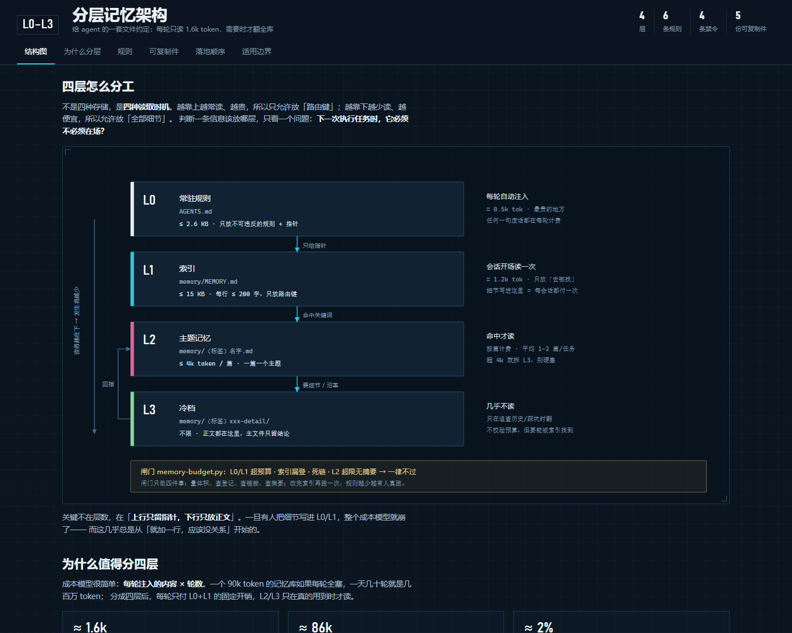

# Agent 记忆架构 · L0–L3

> A four-tier memory layout for LLM agents: keep the per-turn prompt at ~1.6k tokens, load everything else on demand.
>
> 一套可以直接抄的 agent 记忆分层约定：**常驻规则 / 索引 / 主题记忆 / 冷档**。

在线看图：<https://lierkiller.github.io/agent-memory-l0-l3/>



---

## 它解决什么

Agent 的记忆如果每轮都全量塞进上下文，成本就是 **全库体积 × 轮数**。
一套 90k token 的记忆库，一天跑几十轮，就是几百万 token 的固定开销——而且其中 99% 的内容与当前任务无关。

这套结构把记忆拆成四层，按**读取时机**而不是按主题分层：

| 层 | 文件 | 什么时候读 | 预算 | 只允许放什么 |
|---|---|---|---|---|
| **L0** | `AGENTS.md` | 每一轮（系统注入） | ≤ 2.6 KB | 不可违反的规则 + 指针 |
| **L1** | `memory/MEMORY.md` | 每个会话开场一次 | ≤ 15 KB | 路由键：标题 + 链接 + ≤60 字提示 |
| **L2** | `memory/（标签）名字.md` | 命中关键词才读 | ≤ 4k token / 篇 | 一篇一个主题的正文 |
| **L3** | `memory/（标签）xxx-detail/` | 几乎不读 | 不限 | 沿革、勘误、复现细节 |

核心只有一句话：**上行只留指针，下行只放正文。**
判断一条信息放哪层，只问一个问题——下一次执行任务时，它必须不必须在场？

## 快速开始

```bash
git clone https://github.com/lierkiller/agent-memory-l0-l3.git
cd agent-memory-l0-l3

# 1) 用示例库试跑校验脚本（自带一个能通过的完整例子）
python memory-budget.py --home examples

# 2) 照 examples/ 建你自己的库
#    AGENTS.md + memory/MEMORY.md + memory/（标签）主题.md

# 3) 换成你的目录再跑一次
python memory-budget.py --home ~/.agent-home
```

脚本只依赖标准库（Python 3.8+），退出码 `0` = 通过，`1` = 有违规。

想把它挂成 CI 闸门，把 [`ci/github-actions.yml`](ci/github-actions.yml) 复制到你自己仓库的
`.github/workflows/budget.yml` 即可（推工作流文件需要带 `workflow` 权限的 token）。

## 校验脚本做什么

闸门只做四件事，规则越少越有人真跑：

1. **量体积**：L0 / L1 是否超预算，索引行是否过长
2. **查登记**：每个 L2 文件是否都能从 L1 找到
3. **查链接**：L1 里每条链接是否指向真实文件
4. **查摘要**：L2 超预算时，前 45 行内是否有「先读这里」头部摘要

输出示例：

```
L0    2.3 KB  ~  471 tok   AGENTS.md
L1    5.3 KB  ~ 1129 tok   memory/MEMORY.md
L2  396.0 KB  ~85896 tok   52 个主题记忆
L3  469.1 KB               7 个冷档目录 / 101 个文件（不校验预算）
--------------------------------------------------------------
每轮固定开销 ≈ 1600 tok（L0 471 + L1 1129）
全库（L2+L3）≈ 85896 tok 文本 / 865.1 KB

[OK] 全部通过
```

完整逻辑见 [`memory-budget.py`](memory-budget.py)，预算常量都在文件头部，改一行就能调。

## 六条规则

1. **分类前置命名**：`（标签）名字.md`，文件名与 frontmatter 的 `name` 同形；冷档目录同样前置。
2. **索引只放路由键**：一行 = 标题 + 链接 + 60 字内提示。写细节 = 给未来每一轮加税。
3. **L0 只放规则和指针**：环境清单、目录结构这类「资料」一律进 L2。
4. **超预算先加头部摘要**：L2 超 4k token 或 200 行，就在前 45 行内写清「当前状态 / 该跳读哪几节 / 最新变化在哪」。
5. **拆冷档而不是删正文**：沿革与细节搬 `*-detail/`，主文件留结论 + 一行指针。
6. **改名要全库扫链接**：改 `name` 会让按裸名寻址的 `[[wikilink]]` 全部失效，改前备份、改后跑闸门。

### 四条禁令

- 禁止把细节写进索引
- 禁止把资料写进常驻规则
- 禁止把详情堆回速查表
- 禁止为同一主题再开新文件

## 仓库结构

```
.
├── memory-budget.py          # 闸门脚本（只用标准库）
├── docs/
│   ├── index.html            # 四层结构图（单文件，可离线打开 / GitHub Pages）
│   └── preview.png           # README 用截图
├── examples/                 # 可直接跑通的最小示例库（内容均为虚构）
│   ├── AGENTS.md             # L0
│   └── memory/
│       ├── MEMORY.md         # L1
│       ├── （环境）runtime.md        # L2
│       ├── （技术）build-issues.md   # L2
│       └── （技术）build-issues-detail/   # L3
└── ci/github-actions.yml     # 想开 CI 就把这个文件复制到 .github/workflows/
```

## 适用边界

**成立的前提**：① agent 每轮会注入一份固定的 instructions 文件；② 能读写本地文件；③ 检索靠「读索引 + 关键词命中」，不依赖向量库。

**不解决的**：

- **语义检索**——这是关键词路由，找不到「意思相近但词不同」的记忆，需要另加检索层。
- **多人协作**——改名会打断链接，多人同时改索引要先约定唯一写入者。
- **跨设备同步**——文件树会漂，得靠版本库或同步盘。

预算数字（2.6 KB / 15 KB / 4k token / 200 行）是从一套实际运行数月的库中标定出来的**量级参考**，不是标准答案；先抄，跑一周再按自己的情况调。

## License

MIT —— 拿去改、拿去商用都行，不用署名。
